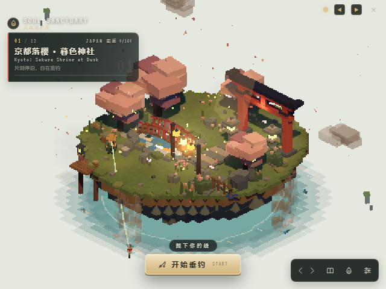
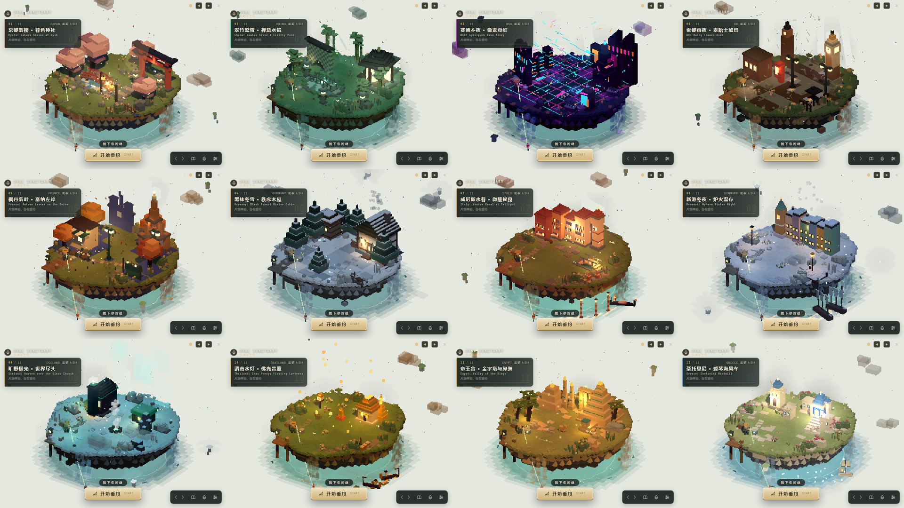
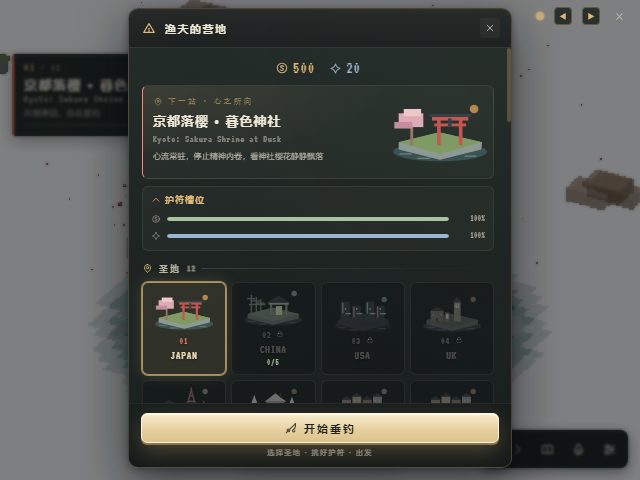

# 🎣 Soul Sanctuary: Depth Fishing

> **灵魂避难所 · 深渊垂钓** — Cast your line into pixelated waters across 12 global sanctuaries. Catch spirit fish, build your compendium, and find peace in a meditative low-poly fishing journey.

<p align="center">
  
  
  
  
  
</p>

<p align="center">
  
</p>

---

## 📖 目录

- [概述](#-概述)
- [视觉风格](#-视觉风格)
- [核心玩法](#-核心玩法)
- [Roguelike 系统](#-roguelike-系统)
- [12 个圣地](#-12-个圣地)
- [鱼鉴系统](#-鱼鉴系统)
- [桌面 Widget 特性](#-桌面-widget-特性)
- [操作指南](#-操作指南)
- [进度系统](#-进度系统)
- [技术栈](#-技术栈)
- [快速开始](#-快速开始)
- [项目结构](#-项目结构)
- [设计文档](#-设计文档)
- [贡献指南](#-贡献指南)
- [路线图](#-路线图)
- [许可](#-许可)

---

## 🎯 概述

**Soul Sanctuary** 是一款桌面钓鱼 Roguelike 伴侣应用。它不是传统的"游戏"——它是一扇通往 12 个像素化圣地的窗户，悬浮在你的桌面上。在工作间隙按下 `Ctrl+Shift+F`，抛一竿，感受 20 秒的张力博弈，然后回到工作中。

### 设计理念

| 理念 | 说明 |
|------|------|
| **桌面优先** | 小型悬浮窗，不抢焦点，可扫视，单手操作 |
| **轻度 Roguelike** | 表层休闲，深层构筑 Synergy 组合 |
| **艺术即身份** | 400×300 像素化低多边形不是限制，是基因 |
| **尊重时间** | 无 FOMO 惩罚，无体力系统，随时暂停，一趟 5-15 分钟 |
| **文化敬畏** | 12 个圣地尊重真实文化灵感 |

### 目标用户

> 一位开发者 / 设计师 / 写作者，想要在屏幕角落里有一个小而美的窗口。他们在任务间隙抛一竿。3D 圣地在呼吸。鱼咬钩——按住鼠标 20 秒的张力小游戏——然后回去工作。数周内，解锁全部 12 个圣地，收集 140 条精灵鱼。

---

## 🎨 视觉风格

### 低保真像素低多边形（Retro Low-Poly Pixel Art）

Soul Sanctuary 使用 **400×300 / 560×420 / 640×480 原生缓冲 + CSS 像素化显示**，正交相机展示由 `BoxGeometry` 体素块构建的微缩场景，水面使用水平面片，**不使用任何外部纹理或模型文件**。

### 第三轮美术升级 · 岸边生活（2026-10-22）

- **完整浮岛**：修复京都、中国、赛博、英国、法国、德国六个场景缺失地形的问题，12 个圣地共享连续台地与分层岩壁。
- **清透水面**：消除重叠透明方块的网格感，补全岛下水域；五档水色向外淡出，整圈水幕改为三处局部跌水。
- **岸边生活**：新增按地点配色的花园、雪覆灌木、芦苇、木栈钓位、木箱、桶和岸灯；蝴蝶、夜间光点与游鱼缓慢活动。
- **旅行手账界面**：12 张原创 SVG 地标插画、营地目的地卡、地点编号铭牌、黄铜色镜头控件和统一工具栏；400×300 小窗下主按钮与工具栏互不遮挡。
- **透明桌面**：移除窗口级灰色光晕，空白区域保持透明；保留像素体素风格与中英双语。

<p align="center">
  
  
</p>

实现、参考与复验步骤见 [第三轮美术升级记录](docs/art-upgrade-v3.md)。截图均来自实际 Electron 程序；浅色底仅用于文档展示，应用窗口仍然透明。

| 视觉特性 | 说明 |
|----------|------|
| **渲染分辨率** | 400×300（内部），通过 `image-rendering: pixelated` CSS 放大 |
| **几何体** | 建筑/树木/鱼使用 BoxGeometry 体素；水面采用无侧壁的水平 PlaneGeometry 实例 |
| **材质** | `MeshLambertMaterial` + `flatShading: true`，无平滑法线 |
| **光照** | 五灯结构：低环境光 + 暖/冷主光 + 轮廓光 + 水面点光 + 半球反弹；阴影收紧到岛体 |
| **后期** | `PostFX`：曝光/对比/饱和、暖冷分离、亮部泛光、alpha 遮罩暗角、4×4 Bayer 抖动（透明像素不变） |
| **配色** | 12 个地点各有一套 **6 色脚本**（key/shadow/base/accent/glow/veil），写入 `location-data.ts` |
| **浮岛** | 7 层手工台地（草皮 0.25 网格 + 土坡 + 3 层岩层 + 水下岛尖），InstancedMesh 地形与水面 |
| **水面** | 完整水平水域、5 档深度色带与外缘渐隐、细泡沫与短弧波纹、短横向倒影、局部跌水、游鱼 |
| **远景** | 透明窗口不使用地平线剪影：改为微型浮岛 + 半透明云 + 岛底薄雾，环绕时自然提供景深 |
| **粒子** | 12 种粒子类型（樱花瓣/萤火虫/霓虹雨/极光等），每场景 80+ |
| **窗口** | 透明背景，浮岛悬于桌面，无窗口级灰色蒙层，frameless 自定义标题栏 |

### 参考作品（只借方法，不取素材）

[同款游戏美术拆解](docs/art-reference-analysis.md) 与 [美术方向 v2](docs/art-direction-v2.md) 记录了从 [WEBFISHING](https://lamedeveloper.itch.io/webfishing)、[Tiny Glade](https://store.steampowered.com/app/2198150/Tiny_Glade/)、[Cast n Chill](https://store.steampowered.com/app/3483740/Cast_n_Chill/)、[Rusty's Retirement](https://store.steampowered.com/app/2666510/Rustys_Retirement/)、[Dorfromantik](https://store.steampowered.com/app/1455840/Dorfromantik/) 等作品借鉴的构图、光色、水面与 UI 层级方法。所有模型、配色、界面仍为 100% 原创程序化生成。


### 地面永远比物体亮

参考 Rusty's Retirement、Tiny Glade、Kind Words 等治愈系游戏的设计原则——地面负责反射环境光。浮岛三层（石/土/草）使用暖色系，配合 `HemisphereLight` 让岛屿底部也能接收温暖反弹光，消除"黑洞桌面"问题。

---

## 🎮 核心玩法

### 钓鱼循环（每轮约 25-35 秒）

```
选择地点 → 营地准备 → 按住蓄力 → 松手抛竿 → 等待鱼咬钩
    → 点击收线 → 按住拉扯/松开泄力 → 钓上/逃脱 → 回到待机
```

#### 1. 投掷（Cast）

- **按住鼠标**蓄力，屏幕显示威力条
- < 30% 威力：🏖️ **表层区** — 常见鱼权重高
- 30-70% 威力：🎯 **中层区**（最佳）— 全鱼种平衡
- 70-90% 威力：🌊 **深层区** — 稀有鱼权重 +30%
- \> 90% 威力：⚠️ **超应力** — 可能断线！

#### 2. 等待（Wait）

- 浮标在水面上轻轻摆动
- 可点击"线抖"消耗 **3 次/趟的主动探测**：立即触发咬钩判定，稀有鱼权重 +30%
- 鱼咬钩时：**音效提示** + 浮标下沉 + 水花粒子

#### 3. 收线搏斗（Reel）

- **按住鼠标** = 收线（张力上升，鱼靠近）
- **松开鼠标** = 泄力（张力下降，鱼拉远）
- 张力条三色区：
  - 🟢 **绿色 0-50%**：安全区，进度 ×1.3
  - 🟡 **黄色 50-70%**：警戒区，进度 ×0.75
  - 🔴 **红色 70-100%**：危险区，线磨损 + 仅 ×0.25 进度
- 6 种鱼行为：Steady（平稳）/ Sprint（冲刺）/ Lazy（慵懒）/ Zigzag（锯齿）/ DeepDiver（深潜）/ SurfaceJumper（跃水）

#### 4. 结算（Catch）

| 结果 | 条件 | 倍率 |
|------|------|:----:|
| Perfect Catch | 全程未进入红色区 | 1.5× 金币 |
| Standard Catch | 正常捕获 | 1.0× |
| Struggle Catch | 线耐久 < 10% | 0.6× 金币 |
| Spirit Variant | 2% 概率异色版 | 3.0× 金币 |
| Trophy Size | > 95% 最大体型 | 2.0× 金币 |
| Mythic Fish | 传说级捕获 | 全屏特效 + 窗口闪烁 |

---

## 🏕️ Roguelike 系统

### Run 机制

每次钓鱼是一次"探险"（Run）。一趟 Run 有 **12-20 次抛竿**机会，共享 **100% 线耐久度**。

Run 可在三种情况下结束：
1. 抛竿次数耗尽
2. 线耐久归零（断线）
3. **主动收杆回家**（首次捕获后可选择）— 保留所有已获收益 + 20% 金币奖励

### 护符（Charm）— 28 种

Run 开始前从随机护符中选择 3 张（可升级至 7 张）。护符通过标签系统产生 Synergy 组合效果。

| 稀有度 | 数量 | 示例 |
|--------|:----:|------|
| Common | 10 | Magnetic Hook（钩窗+40%）、Patient Spirit（张力+20%慢）|
| Uncommon | 9 | Fisherman's Luck（稀有鱼+35%）、Reinforced Line（线耐久+40%）|
| Rare | 7 | Golden Touch（全鱼金币+50%）、Zen Master（绿区翻倍）|
| Cursed | 2 | Cursed Line（张力+50% 但进度×2）、Gambler's Die（50% ×3或×3张力）|

**Synergy 自动检测**（5 种组合）：
- 3+ tension 标签 → Tension Mastery（绿区 +10%）
- 2+ hook 标签 → Keen Senses（钩窗 +0.3s）
- tension + durability → Balanced Approach（泄力速度 +3）
- 2+ progress 标签 → Momentum（基础进度 +2）
- 2+ cast 标签 → Deep Casting（投掷深度 +15%）

### 遗物（Relic）— 8 种

永久装备，跨 Run 生效。通过稀有事件或特殊条件解锁。

| 遗物 | 效果 | 解锁条件 |
|------|------|----------|
| 🧭 Ancient Compass | 稀有鱼 +15% | 在全部 12 个圣地钓过鱼 |
| 🏮 Spirit Lantern | 异色变体 +8% | 捕获 5 条异色鱼 |
| 🪝 Titanium Hook | 钩窗 +60% | 达成 10 次 Perfect Catch |
| 🐉 Dragon Gut Line | 线耐久翻倍 | 捕获一条 Mythic 鱼 |
| 🪙 Midas Coin | 金币 ×1.5 | 累计获得 10,000 金币 |
| ⚓ Sailor's Anchor | 进度不低于 10% | 逃脱 5 次 |
| 🪶🔥 Phoenix Feather | 每 Run 抵消 1 次断线 | 经历 3 次断线 |
| 🪨 Echo Stone | 30% 概率捕获不消耗抛竿 | 完成一趟无逃脱 Run |

### 随机事件 — 10 种

每次抛竿后有 30% 概率触发事件，包含祝福、诅咒和双选抉择。

### 营地升级 — 5 条线

用金币 + 灵魂精华永久升级营地：

| 升级线 | 最高等级 | 效果 |
|--------|:--------:|------|
| Charm Slots | 4 | 每 Run 可选更多护符（3→7），Lv4 解锁 Synergy 槽 |
| Relic Slots | 3 | 可装备更多遗物（0→3）|
| Charm Rerolls | 3 | 护符选择时可重骰次数（1→3）|
| Bait Pouch | 5 | 携带更多鱼饵（3→13）|
| Line Durability | 5 | 基础线耐久提升（100→200）|

---

## 🌍 12 个圣地

| # | 地点 | 氛围 | 特征 |
|---|------|------|------|
| 1 | 🇯🇵 **京都 · 樱落神社** | 黄昏神社 | 鸟居、石灯笼、樱花飘落、锦鲤池 |
| 2 | 🇨🇳 **中国 · 翠竹流萤** | 月夜竹林 | 萤火虫、禅意池塘、石灯、新月 |
| 3 | 🇺🇸 **美国 · 赛博霓虹** | 赛博朋克暗巷 | 霓虹网格、服务器机架、数据雨、"404"招牌 |
| 4 | 🇬🇧 **英国 · 雾都雨夜** | 泰晤士河码头 | 砖墙、维多利亚灯柱、大本钟剪影、雨 |
| 5 | 🇫🇷 **法国 · 枫丹落叶** | 秋日塞纳河畔 | 埃菲尔铁塔、梧桐树、书摊、落叶 |
| 6 | 🇩🇪 **德国 · 黑林冬雪** | 冬季黑森林 | 木屋、松树、雪、烟囱炊烟、木柴堆 |
| 7 | 🇮🇹 **意大利 · 威尼斯水巷** | 黄昏运河 | 彩色建筑、拱桥、贡多拉、暮光 |
| 8 | 🇩🇰 **丹麦 · 新港冬夜** | 新港运河 | 彩色联排屋、雪、港口灯 |
| 9 | 🇮🇸 **冰岛 · 旷野极光** | 极光教堂 | 黑教堂、极光带、火山岩、雪 |
| 10 | 🇹🇭 **泰国 · 湄南水灯** | 水灯节 | 金色佛塔、莲花、水灯、天灯 |
| 11 | 🇪🇬 **埃及 · 帝王谷** | 沙漠黄昏 | 金字塔、方尖碑、神庙柱、棕榈树 |
| 12 | 🇬🇷 **希腊 · 圣托里尼** | 爱琴海蓝白 | 白墙蓝窗、风车、蓝顶教堂、海 |

每个地点有 11-12 种独特的精灵鱼（共 **140 种**），受时间、天气、季节、鱼饵四维过滤。

---

## 🐟 鱼鉴系统（Fishpedia）

### 稀有度分布

| 稀有度 | 比例 | 视觉标识 | 每地点 | 全球 |
|--------|:----:|----------|:------:|:----:|
| Common | 45% | 白色名 | 5 | 60 |
| Uncommon | 30% | 绿色名 | 3 | 36 |
| Rare | 15% | 蓝色名 + 闪光 | 2 | 24 |
| Legendary | 8% | 金色名 + 光环 | 1-2 | 15 |
| Mythic | 2% | 彩虹名 + 全屏特效 | 0-1 | 6 |

### 鱼饵（5 种）

| 鱼饵 | 价格 | 稀有加成 | 等待缩减 |
|------|:----:|:--------:|:--------:|
| 🪱 Earthworm | 免费 | 0% | 0s |
| 🍞 Bread | 10G | +5% | -1s |
| 🦐 Shrimp | 25G | +15% | -2s |
| 🪝 Spoon Lure | 50G | +25% | -3s |
| ✨ Spirit Paste | 100G | +40% | -4s |

---

## 🖥️ 桌面 Widget 特性

Soul Sanctuary 是一款**桌面伴侣应用**——设计为在工作间隙随时抛一竿。

| 特性 | 说明 |
|------|------|
| **Frameless 窗口** | 自定义 4px 标题栏，可拖拽 |
| **透明背景** | 浮岛悬于桌面，周围透明 |
| **全局快捷键** | `Ctrl+Shift+F` 切换钓鱼/观赏模式 |
| **系统托盘** | 右键菜单：开始钓鱼/切换地点/始终置顶/退出 |
| **窗口闪烁** | 鱼咬钩/Mythic 捕获时闪烁任务栏 |
| **位置记忆** | 记住上次窗口位置 |
| **分辨率预设** | Compact(400×300) / Standard(560×420) / Large(640×480) |
| **开机自启** | 可选随系统启动 |
| **始终置顶** | 可选窗口置顶 |

---

## ⌨️ 操作指南

| 操作 | 桌面（鼠标） | 快捷键 |
|------|-------------|--------|
| 开始钓鱼 | 点击画面 | `Ctrl+Shift+F` |
| 蓄力抛竿 | 按住左键（1-2秒后松开）| — |
| 线抖/主动探测 | 等待时点击 | — |
| 刺鱼（Hook Set）| 鱼咬钩后点击 | — |
| 收线 | 按住左键 | — |
| 泄力 | 松开左键 | — |
| 旋转视角 | 标题栏 ◀▶ 按钮 | — |
| 打开鱼鉴 | — | `F` |
| 打开设置 | 标题栏设置按钮 | `Esc` |

---

## 🛠️ 技术栈

背景音乐包含 **Abyssal Lamps / bruise of ink / Lingering Threshold** 三首原始 WAV。
首次点击或按键后开始顺序循环；切换圣地不会打断播放。在设置面板中可以选曲、开关音乐、调节音量，偏好会自动保存。

| 层级 | 技术 |
|------|------|
| 框架 | TypeScript + Vite |
| 3D 渲染 | Three.js（OrthographicCamera，flatShading）|
| 桌面壳 | Electron（frameless，tray，globalShortcut）|
| 状态管理 | 事件驱动 EventBus + GameStateManager |
| 持久化 | localStorage（3 槽位 + 自动保存）|
| 音频 | Web Audio API 合成音效与环境音 + 本地 WAV 背景音乐歌单 |
| 随机数 | Seeded PRNG（mulberry32，可复现 Run）|
| 样式 | CSS Custom Properties + 像素化放大管线 |

---

## 🚀 快速开始

### 环境要求

- **Node.js** >= 18
- **npm** >= 9

### 安装与运行

```bash
# 克隆仓库
git clone https://github.com/your-username/soul-sanctuary.git
cd soul-sanctuary

# 安装依赖
npm install

# 浏览器开发模式（Vite only，适合调试 UI）
npm run dev

# Electron 开发模式（完整桌面体验）
npm run dev:electron

# 构建生产版本（含 Electron 安装包）
npm run build

# 仅构建 Windows 安装包
npm run build:win

# 类型检查
npm run typecheck

# 代码检查
npm run lint

# 格式化代码
npm run format

# 运行测试
npm test
npm run test:smoke

# 实机美术复验：12 地点 + 三档窗口 + 渲染预算 + 透明度
$env:ART_OUTPUT='screenshots/art-v3'
node scripts/art-review.cjs
```

---

## 📁 项目结构

```
SoulSanctuary/
├── src/
│   ├── main/              # Electron 主进程（窗口管理/托盘/IPC）
│   ├── renderer/
│   │   ├── core/          # EventBus, GameLoop, RNG, InputManager
│   │   ├── fishing/       # FishingSystem, FishSpawner, FishingSceneManager
│   │   ├── roguelike/     # RunManager, CampManager, ModifierEngine, charms, relics, events
│   │   ├── rendering/     # Renderer, Pipeline, FloatingIsland, Bobber, VoxelFishModel…
│   │   ├── locations/     # 12 个圣地场景构建器 + BaseLocation
│   │   ├── data/          # 140 条鱼数据、地点元数据、每日系统
│   │   ├── ui/            # FishingUI, RunUI, Fishpedia, DraggablePanel, SceneUI
│   │   ├── audio/         # Web Audio API 音效引擎 + WAV 背景音乐播放器
│   │   └── i18n/          # 中英双语支持
│   └── shared/            # 类型定义、枚举、事件映射、常量
├── docs/                  # GDD, TDD, SDD, 架构文档, 审核报告
├── scripts/               # 图标生成、数据验证等工具脚本
├── tests/                 # Playwright E2E + 单元测试
├── assets/                # 图标资源
├── public/music/          # 三首 WAV 背景音乐（随构建打包）
└── screenshots/           # 截图展示
```

---

## 📝 设计文档

| 文档 | 说明 |
|------|------|
| [`GDD.md`](docs/GDD.md) | 游戏设计文档（Game Design Document）|
| [`TDD.md`](docs/TDD.md) | 技术设计文档（Technical Design Document）|
| [`SDD.md`](docs/SDD.md) | 软件设计文档（Software Design Document）|
| [`architecture.md`](docs/architecture.md) | 架构设计记录（Architecture Design Record）|
| [`art-review.md`](docs/art-review.md) | 12 场景美术审核 |
| [`art-direction-v2.md`](docs/art-direction-v2.md) | 第二轮美术方向与硬性规范（微光圣地） |
| [`art-reference-analysis.md`](docs/art-reference-analysis.md) | 同类游戏美术拆解（10 款，含引用） |
| [`art-upgrade-v2.md`](docs/art-upgrade-v2.md) | 第二轮美术升级交付记录 |
| [`art-upgrade-v3.md`](docs/art-upgrade-v3.md) | 第三轮升级：完整地形、清透水面、岸边生活与旅行手账界面 |
| [`design-audit.md`](docs/design-audit.md) | 游戏设计深度审核（8 维 16 项）|
| [`camp-audit.md`](docs/camp-audit.md) | 营地系统设计审核 |
| [`market-research.md`](docs/market-research.md) | 市场调研与竞品分析 |

---

## 🤝 贡献指南

我们欢迎任何形式的贡献！无论是 Bug 报告、功能建议、代码贡献还是文档改进。

### 如何贡献

1. **Fork** 本仓库
2. 创建你的特性分支：`git checkout -b feature/amazing-feature`
3. 提交你的更改：`git commit -m 'feat: add amazing feature'`
4. 推送到分支：`git push origin feature/amazing-feature`
5. 提交 **Pull Request**

### 提交规范

本项目使用 [Conventional Commits](https://www.conventionalcommits.org/) 规范：

- `feat:` 新功能
- `fix:` Bug 修复
- `docs:` 文档更新
- `style:` 代码格式（不影响功能）
- `refactor:` 代码重构
- `test:` 测试相关
- `chore:` 构建/工具链更新

### 代码风格

- 使用 TypeScript 严格模式
- 遵循 ESLint + Prettier 配置
- 提交前运行 `npm run typecheck && npm run lint`
- 确保所有测试通过：`npm test`

详见 [`CONTRIBUTING.md`](CONTRIBUTING.md)

---

## 🗺️ 路线图

- [x] 12 个圣地场景构建
- [x] 核心钓鱼循环（Cast → Wait → Hook → Reel → Catch）
- [x] Roguelike Run 机制（护符/遗物/事件/Synergy）
- [x] 鱼鉴收集系统（140 种鱼）
- [x] 桌面 Widget 特性（透明窗口/托盘/全局快捷键）
- [x] 中英双语支持
- [x] 营地升级系统
- [x] 第三轮美术升级（12 圣地共享岸景、地标插画、水面与小窗适配）
- [x] 本地背景音乐歌单、音量与播放偏好保存
- [ ] 音效系统完善
- [ ] Steam 发布
- [ ] 排行榜与社区功能
- [ ] 更多鱼种与圣地

---

## ⭐ 致谢

- [Three.js](https://threejs.org/) — 3D 渲染引擎
- [Electron](https://www.electronjs.org/) — 桌面应用框架
- [Vite](https://vitejs.dev/) — 构建工具
- [Rusty's Retirement](https://store.steampowered.com/app/2666510/Rustys_Retirement/) — 视觉灵感
- [Tiny Glade](https://store.steampowered.com/app/2198150/Tiny_Glade/) — 氛围参考
- [Kind Words](https://store.steampowered.com/app/1070710/Kind_Words_lo_fi_chill_beats_to_write_to/) — 治愈系设计参考

---

## 📄 许可

本项目基于 [MIT License](LICENSE) 开源。

---

*Soul Sanctuary: Depth Fishing — Find peace in pixelated waters. 🎣*
