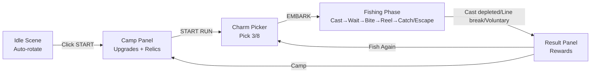

# 🔍 QA Review: Soul Sanctuary — Phase 4

> **Role**: QA Lead  
> **Date**: 2026-06-06  
> **Scope**: Full gameplay loop, bugs, fun factor, replayability, completion assessment

> **更新日志（2026-06-22）**: 本报告中以下问题已在代码修复阶段解决：
> - **B1** — 营地面板已支持地点选择，Run 不再固定 Japan。
> - **B2** — 持久化已接通：`GameStateManager` 使用 localStorage + Electron 文件双保险，退出时文件保存，启动时优先从文件加载。
> - **B3** — `GameStateManager` 已监听 `FISHING_CATCH` 并实时更新 Fishpedia。
> - **B4** — 遗物系统已生效：已装备遗物会随 Run 传入 `ModifierEngine`。
> - **B5** — `CharmPicker` 已按 `campManager.charmSlots` 限制选择数量。
> - **B9** — 每日奖励已接入：`GameStateManager` 监听 `DAILY_QUEST_COMPLETED` / `DAILY_STREAK_REWARD` / `DAILY_FREE_BAIT_CLAIMED`。
> - **B11** — 设置面板版本号已改为读取 `APP_VERSION`（`package.json` 中的 `0.1.0`），不再硬编码。  

---

## 1. Gameplay Loop Audit

### Current Loop (as implemented)



### Loop Assessment

| Aspect | Status | Notes |
|--------|--------|-------|
| Camp → Prep → Fishing → Results → Camp | 🟡 Works but fragile | Loop exists, but no state persistence between sessions |
| Voluntary end incentive | 🟢 Good | 20% gold bonus + 2 tokens vs 1 for depleted |
| Cast economy | 🟢 Balanced | 16 base casts, modified by charms |
| Line durability pressure | 🟢 Good | Creates tension in red zone |
| Charm impact on gameplay | 🟢 Visible | ModifierEngine flows stats into FishingSystem |

### 🔴 Critical Gap: Progression Persistence

The entire meta-progression (gold, essence, camp upgrades, owned relics, fishpedia) **exists only in RAM** inside [`RunUI.ts`](src/renderer/roguelike/RunUI.ts). All data is lost on page reload. The game currently has no save/load integration despite having:
- `SaveData` types defined in [`types.ts`](src/shared/types.ts)
- `save/load` IPC handlers in [`main/index.ts`](src/main/index.ts)
- `game:save` / `game:load` events in [`events.ts`](src/shared/events.ts)

This is the **single largest barrier** to being a functional game for repeated play.

---

## 2. Bug Report

### 🔴 Critical (blocks core gameplay)

| ID | Bug | Location | Impact |
|----|-----|----------|--------|
| B1 | **All runs use Japan only** | [`RunUI.ts:259`](src/renderer/roguelike/RunUI.ts:259) — `this.runManager.startRun('japan', picked)` | 11 locations inaccessible |
| B2 | **No data persistence** | Gold/essence/upgrades/relics stored in RunUI RAM only | All progress lost on reload |
| B3 | **Fishpedia never updated** | RunManager.fishCaught not synced to Fishpedia system | Core collection mechanic broken |
| B4 | **Relics never earned** | Only `relic_compass` hardcoded; `RunRewards.relicDiscovered` always null | 8 relics defined but unreachable |

### 🟡 Medium (blocks features)

| ID | Bug | Location | Impact |
|----|-----|----------|--------|
| B5 | **Charm slot count ignored** | Charm picker always shows 8, always picks 3 regardless of `charmSlots` upgrade | Upgrades don't affect gameplay |
| B6 | **Event rewards not persisted** | Temp modifiers created via `_applyChoice` have empty names/descriptions | Rewards invisible to player |
| B7 | **Run result auto-dismiss after 5s** | [`RunManager.ts:201`](src/renderer/roguelike/RunManager.ts:201) — `setTimeout` for 5s | Player may not see rewards before dismiss |
| B8 | **Location change during run unsupported** | [`index.ts:124`](src/renderer/index.ts:124) calls `nextLocation()` but run is not reset | Scene switches during active run |
| B9 | **Daily rewards have no destination** | DailySystem emits events but no listener deposits gold/essence | Daily quest rewards lost |

### ⚪ Low (cosmetic/UX)

| ID | Bug | Location | Impact |
|----|-----|----------|--------|
| B10 | **Fishing mode toggle has no visible indicator** | `isFishingMode` only used for passthrough toggle | User can't tell if fishing is on/off |
| B11 | **Settings panel shows v0.4.0 but hardcoded** | [`index.ts:144`](src/renderer/index.ts:144) | Manual update needed each version |
| B12 | **Panel stacking not prevented on ESC** | ESC closes panels but interaction between camp/charm/result not clean | Possible UI glitch |

---

## 3. Fun Factor & Replayability Audit

### What Works Well

| Feature | Score | Why |
|---------|-------|-----|
| Scene variety | 🟢 9/10 | 12 gorgeous low-poly sanctuaries with unique atmosphere |
| Fish variety | 🟢 9/10 | 141 fish with lore, rarity tiers, conditions |
| Charm system | 🟢 8/10 | 22 charms with diverse effects, modifier pipeline |
| Random events | 🟢 7/10 | 10 events with meaningful choices, 7 have branching outcomes |
| Camp upgrades | 🟡 6/10 | 5 upgrades exist but aren't felt (no persistence, no charm slot impact) |
| Fishing mechanics | 🟢 8/10 | Solid state machine, tension bar, behavior AI |

### What's Missing for Replayability

| Gap | Impact | Fix Priority |
|-----|--------|-------------|
| **Save/Load** | All progress reset on reload. Cannot "come back tomorrow" | 🔴 P0 |
| **Location rotation** | 11 beautiful scenes exist but player can't reach them | 🔴 P1 |
| **Fishpedia growth** | Core collection motivation non-functional | 🔴 P1 |
| **Relic acquisition** | 8 relics exist but can't be earned | 🟡 P2 |
| **Daily challenge integration** | System built but not connected to UI/rewards | 🟡 P2 |
| **Location-based variety** | Each location should have different fish pools — exists in data but not in flow | 🟡 P2 |
| **Achievement feedback** | No achievement system | ⚪ P3 |
| **Session stats/history** | No way to see lifetime stats | ⚪ P3 |

### Randomness Audit

| System | Randomness | Quality |
|--------|-----------|---------|
| Fish spawn | Seeded RNG, weighted by rarity, filtered by time/weather/season | 🟢 Good |
| Charm pool | Random 8 from 22, reroll available | 🟢 Good |
| Events | 30% per cast, equally weighted from 10 | 🟢 Good |
| Fish behavior | 6 behavior types (Steady/Sprint/Lazy/Zigzag/DeepDiver/SurfaceJumper) | 🟢 Good |
| Run seed | Generated per run for determinism | 🟢 Good |

---

## 4. Completion Assessment

### Is Soul Sanctuary a Mature Casual Fishing Roguelike?

```
Core Loop:        ✅ Camp→Prep→Fish→Reward→Camp
Charm Drafting:   ✅ Pick 3/8 with rerolls
Modifier Engine:  ✅ stat_add/stat_mult/condition pipeline
Random Events:    ✅ 10 events with choices
Fish Variety:     ✅ 141 fish, 5 rarities
Location Variety: ✅ 12 scenes with unique 3D assets
Fishing Mechanics:✅ Cast→Wait→Bite→Reel state machine
Meta Progression: 🟡 Upgrades defined but not persistent
Collection:       🟡 Fishpedia defined but not populated
Persistence:      🔴 None — all progress lost on reload
```

### Verdict: **Phase 4 Prototype** — 60% complete

The game has all the **mechanical pieces** (fishing, charms, events, upgrades) but lacks the **connective tissue** that makes it a loop the player wants to repeat:

1. **No persistence** means the meta-loop (earn gold → buy upgrades → catch harder fish → earn more gold) doesn't exist across sessions
2. **No fishpedia growth** removes the collection motivation that drives replay
3. **No location rotation** wastes 11/12 of the art investment
4. **No relic acquisition** leaves the most exciting rewards inaccessible

### Priority Roadmap to Completion

| Priority | Task | Makes the game... |
|----------|------|-------------------|
| **P0** | Save/Load system (gold, essence, upgrades, relics, fishpedia) | Playable across sessions |
| **P0** | Wire fishpedia to RunManager catch events | Collection loop functional |
| **P1** | Enable location selection in camp panel | All 12 scenes accessible |
| **P1** | Relic discovery on run end (rare drop from rare+ fish) | Long-term goals exist |
| **P1** | Apply charm slots upgrade to charm picker | Upgrades feel impactful |
| **P2** | Daily challenge UI + reward integration | Daily return incentive |
| **P2** | Fishpedia panel populated with actual catch data | Completion % visible |
| **P2** | Fix event rewards to use proper named modifiers | Event outcomes readable |
| **P3** | Achievement system | Milestone motivation |
| **P3** | Session stats screen | Player can see progress |

---

## 5. Summary

The game is a **well-structured prototype** with strong art, solid mechanics, and a functional core loop. It feels like playing the first 10 minutes of a roguelike — the loop works, but there's no reason to come back because nothing is saved.

**The good**: All 12 scenes look beautiful, the fishing feels satisfying, charms create meaningful build variety, and random events add surprise.

**The gap**: The game currently plays as a "single session demo." To become a real roguelike, it needs persistence (P0) and progression feedback (P1-P2).
