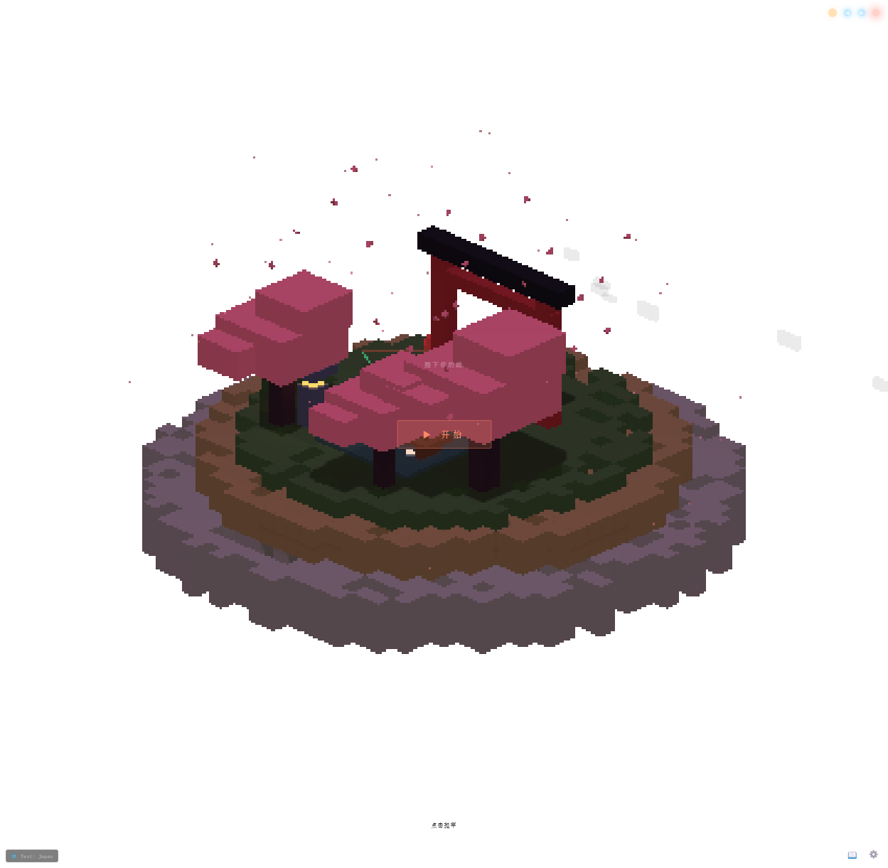
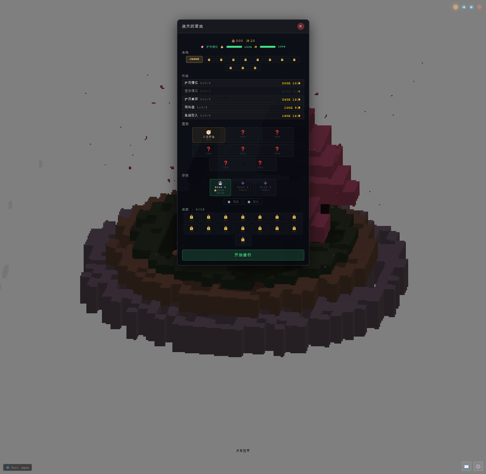
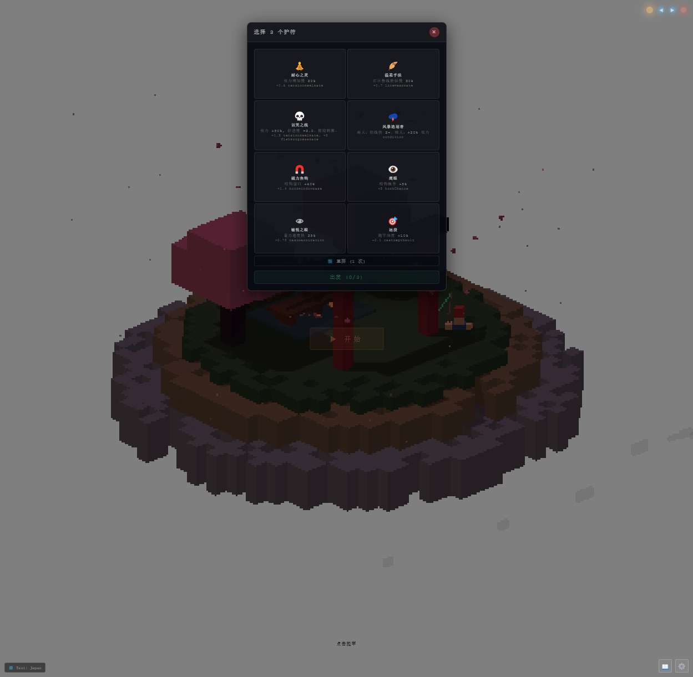
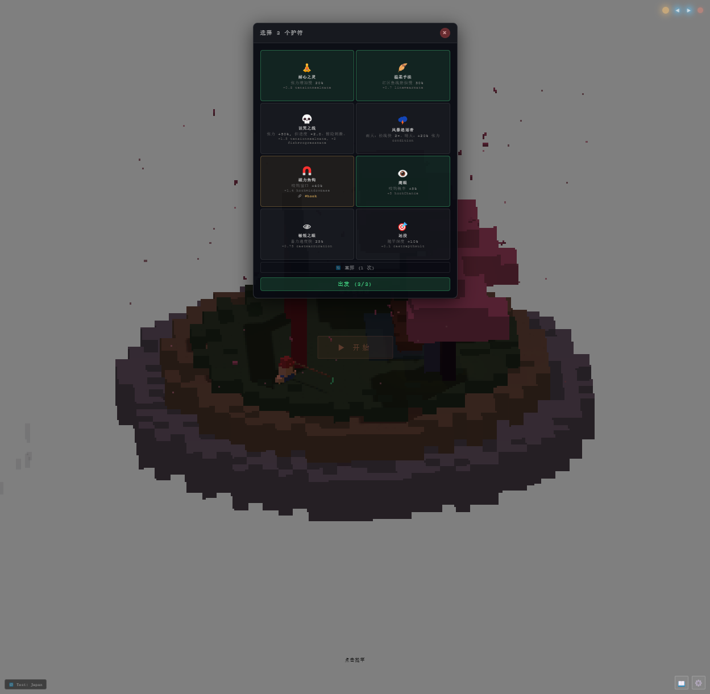
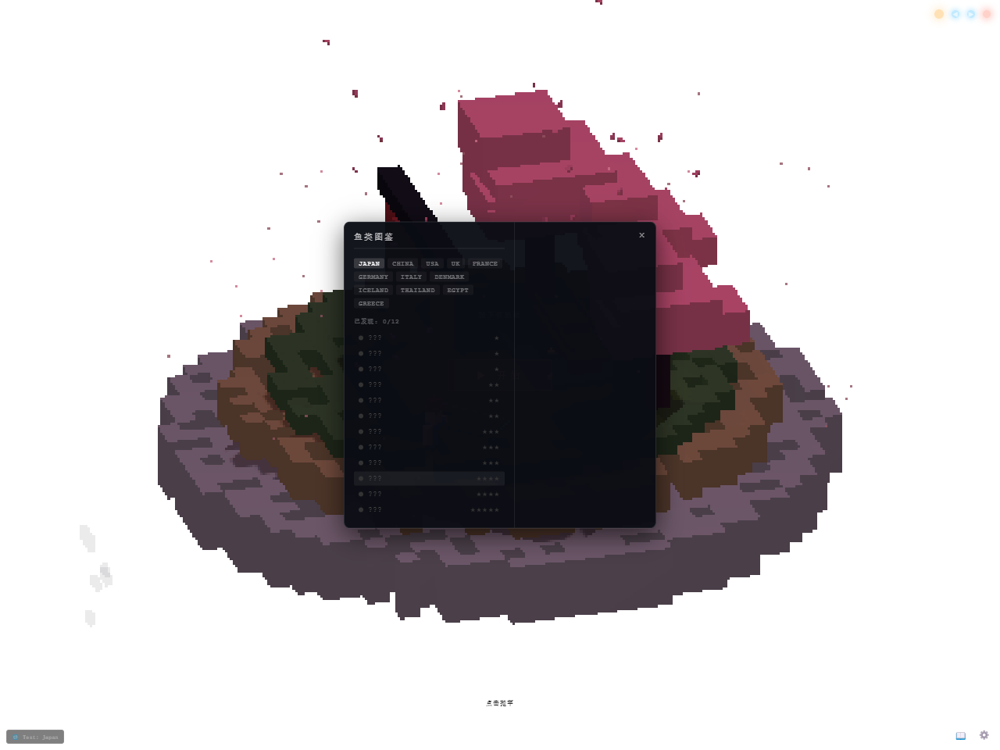
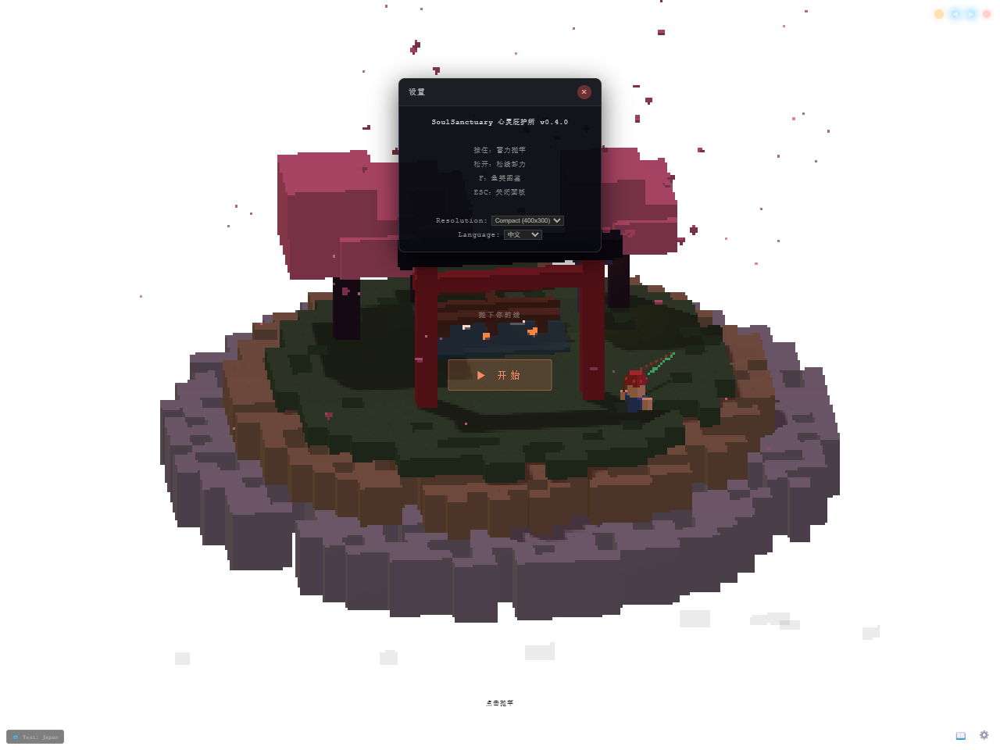
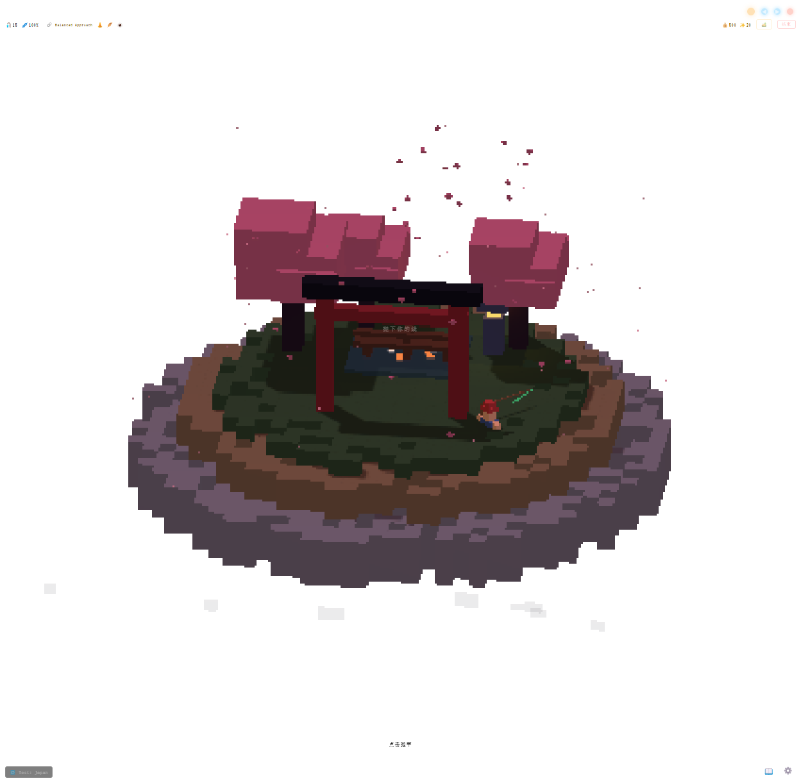

# 🎣 玩家试玩报告：Soul Sanctuary: Depth Fishing

> **版本**：v0.1.0（build 2026-06-16）  
> **平台**：Windows / Electron 桌面 Widget（本次通过浏览器预览版体验）  
> **游玩时长**：约 25 分钟  
> **评测视角**：把它当作一款「桌面伴侣型 Roguelike 钓鱼游戏」来体验

---

## 📊 总评

| 项目 | 评分（10 分制） |
|------|:---------------:|
| **综合体验** | **6.8 / 10** |
| 美术风格 | 8.5 |
| 核心玩法 | 7.0 |
| Roguelike / 构筑深度 | 6.5 |
| 进度 / 收集反馈 | 4.5 |
| 桌面 Widget 体验 | 6.0 |
| 音效 / 演出 | 5.0 |
| 完成度 | 5.5 |

**一句话 verdict**：画面和概念非常治愈，钓鱼手感也有雏形；但当前版本更像一份「可玩的高保真原型」，离让人想长期留在桌面的完整游戏，还差最关键的几块拼图。

---

## 🎨 1. 美术风格：8.5 / 10

### 第一印象
打开窗口的瞬间，一个 400×300 内部分辨率的像素浮岛直接映入眼帘——樱花瓣飘落、鸟居伫立、水面微微反光。这种「低多边形 + 像素放大」的管线确实做出了自己的味道，不是简陋，而是刻意复古。

### 亮点
- **统一的视觉语言**：所有模型都是 BoxGeometry 体素拼成，建筑、树木、角色、鱼全部方块化，没有违和感。
- **12 个圣地各有辨识度**：虽然只有 Japan 能在当前版本进入，但从鱼鉴标签和文档看，中国竹林、冰岛极光、赛博霓虹等场景的色彩和粒子差异很大。
- **氛围粒子到位**：樱花瓣、水波、浮岛底部的暖光，让「桌面小窗」有呼吸感。

### 扣分点
- 画面放大后部分文字（如 HUD 里的抛竿次数、耐久）变得非常小，在高分屏上可读性差。
- 钓鱼时的张力条、刺鱼提示等核心 UI 被压缩在像素画布里，不够醒目。

---

## 🎮 2. 核心玩法：7.0 / 10

### 循环体验
钓鱼循环完整：`蓄力抛竿 → 等待咬钩 → 刺鱼 → 收线/泄力 → 捕获/逃脱`。按键逻辑简单，一只手就能玩，符合桌面伴侣定位。

### 亮点
- **张力博弈有感觉**：收线时按住/松开的二择虽然简单，但配合张力条三色区，确实能让人紧张起来。
- **主动探测是好设计**：等待期可以点击「抖线」主动触发咬钩判定，给了玩家一点事做，避免了纯等待。
- **浮标动画细腻**：抛竿后鱼线、浮标、水花都有独立动画，能看出打磨过。

### 扣分点
- **等待期仍然偏长**：即使有主动探测，连续抛竿时中间的空窗期还是容易让人分心回工作——这可能正是设计意图，但作为「游戏」部分略显单薄。
- **刺鱼窗口不明显**：鱼咬钩时的视觉/音效提示较弱，好几次我反应过来已经错过。
- **缺少教学引导**：第一次进入钓鱼模式时，没有明确提示「现在该做什么」。

---

## 🏕️ 3. Roguelike / 构筑深度：6.5 / 10

### 系统框架
- 22 种护符，每局 8 选 3（升级后可选更多）。
- 8 种永久遗物、10 种随机事件、5 条营地升级线。
- Synergy 标签系统、鱼行为 AI、金币/精华双货币——设计文档非常完整。

### 亮点
- **护符差异明显**：「耐心之灵」降低张力增速、「鹰眼」扩大刺鱼窗口，选择时能感觉到不同流派。
- **事件有分支**：部分事件提供双选，增加了单局内的变量。

### 扣分点
- **Synergy 感受不到**：护符有标签，但游戏内没有提示「你触发了某种组合效果」，玩家只能当数值加减来玩。
- **遗物获取Bug**：除了初始的「古老罗盘」，其他遗物目前无法解锁（QA 报告 B4）。
- **护符槽位升级无效**：购买了更多槽位，但选择界面依然固定 3 选（QA 报告 B5）。
- **单局决策密度低**：除了开局选护符，钓鱼过程中几乎没有需要动脑的选择。

---

## 📈 4. 进度 / 收集反馈：4.5 / 10

这是当前版本最伤的地方。

### 问题清单
| 问题 | 实际表现 |
|------|----------|
| **无存档** | 刷新页面后金币、精华、升级、捕获全部归零。 |
| **鱼鉴不更新** | 即使钓到鱼，图鉴里依然全部显示 `???`（QA 报告 B3）。 |
| **地点无法切换** | 12 个圣地中只能进入 Japan，其余全部锁定（QA 报告 B1）。 |
| **成就无反馈** | 15 个成就图标全是锁，触发条件也不明确。 |

### 玩家感受
> 我钓了十几竿，看到金币从 500 涨到 560，但一刷新页面，一切归零。这种「单机游戏却没有存档」的体验非常打击继续游玩的动力。
>
> 鱼鉴系统看起来很美——141 种鱼、12 个地点——但打开后全是问号，没有任何已捕获记录，收集欲直接归零。

---

## 🖥️ 5. 桌面 Widget 体验：6.0 / 10

### 设计意图
透明背景、frameless 小窗、全局快捷键 `Ctrl+Shift+F`、系统托盘、始终置顶——这些都是为「工作间隙摸鱼」服务的。

### 亮点
- **窗口定位明确**：Compact 400×300 模式下确实只占屏幕一角。
- **空闲自动旋转**：不操作时镜头缓慢环绕浮岛，观赏性不错。
- **多语言支持**：设置里可切换中英文。

### 扣分点
- **浏览器版缺少核心 Widget 特性**：全局快捷键、托盘、窗口置顶等需要 Electron 版才能验证，但 Electron 版在当前环境无法启动（依赖问题）。
- **设置面板版本号写死 v0.4.0**：与 package.json 的 v0.1.0 不一致，显得粗糙（QA 报告 B11）。
- **点击穿透/模式切换没有视觉指示**：玩家分不清当前是「观赏模式」还是「钓鱼模式」。

---

## 🔊 6. 音效 / 演出：5.0 / 10

### 现状
- 钓鱼过程中几乎没有明显音效反馈。
- 鱼咬钩、捕获、断线、钓到 Mythic 鱼等关键时刻都缺乏声音和镜头变化。
- 路线图中「音效系统完善」还未完成。

### 扣分点
- **峰值体验缺失**：钓到稀有鱼时只有一个数字弹窗，没有全屏微光、镜头拉近、音乐高潮——完全配不上「Mythic」这个名字。
- **失败惩罚太硬**：断线后只有一个红色弹窗，没有安慰奖或鼓励提示，挫败感较强。

---

## 🛠️ 7. 完成度：5.5 / 10

### 已完成的（值得肯定）
- ✅ 12 个圣地场景资产
- ✅ 核心钓鱼状态机
- ✅ 22 护符 + 8 遗物 + 10 事件的数据设计
- ✅ 鱼鉴、营地、成就等 UI 框架
- ✅ 中英双语、分辨率切换

### 缺失的连接组织
- ❌ 存档/读档系统
- ❌ 鱼鉴与实际捕获数据同步
- ❌ 地点切换/解锁
- ❌ 遗物获取
- ❌ 营地升级对护符槽位等数值生效
- ❌ Synergy 自动检测与反馈
- ❌ 音效与捕获演出

这和项目自己的 QA 报告结论一致：**Phase 4 原型，约 60% 完成度**。

---

## ✅ 优点总结

1. **视觉风格独特且高度统一**，像素低多边形做出了高级感。
2. **核心钓鱼循环完整**，蓄力、等待、收线、捕获都有独立反馈。
3. **Roguelike 框架清晰**，护符、遗物、事件、升级线设计得有深度潜力。
4. **桌面伴侣定位明确**，小窗、轻交互、随时可停。
5. **文档和代码结构优秀**，GDD/TDD/SDD/QA 一应俱全，能看出团队有工程素养。

---

## ❌ 缺点总结

1. **没有存档**，所有进度刷新即失，这是致命伤。
2. **鱼鉴不更新**，141 种鱼的收集动力无法落地。
3. **地点锁定**，11/12 的美术投资被浪费。
4. **Synergy/升级数值不生效**，构筑深度只停留在纸面。
5. **音效和演出缺失**，Mythic 捕获没有仪式感。
6. **Electron 启动/打包在当前环境有问题**，影响了完整桌面体验的验证。

---

## 💡 给开发者的建议（按优先级）

| 优先级 | 建议 | 预期效果 |
|:------:|------|----------|
| P0 | 接入 `localStorage` / Electron 存档，持久化金币、精华、鱼鉴、升级、遗物 | 从「一次性 demo」变成可重复游玩的游戏 |
| P0 | 把 `RunManager.fishCaught` 同步到 `Fishpedia` | 收集循环立即成立 |
| P1 | 修复地点切换逻辑，让玩家能解锁并进入全部 12 个圣地 | 美术资产的价值得到释放 |
| P1 | 让营地升级真正生效（护符槽位、重掷次数、线耐久等） | 玩家能感知到成长 |
| P2 | 实现 Synergy 自动检测并在 UI 中反馈 | 构筑玩法从「选数值」变成「找 combo」 |
| P2 | 加入音效 + Mythic 捕获演出（镜头、粒子、通知） | 峰值体验和传播点 |
| P3 | 增加失败安慰奖和 tips | 降低断线/逃脱后的退出率 |

---

## 🎯 购买 / 推荐建议

- **现在值得玩吗？**  适合作为「概念验证 demo」体验一下美术和钓鱼手感，**不建议当作长期游戏投入**。
- **什么情况下值得买？**  等 P0 的存档和鱼鉴修复后再考虑。
- **推荐给谁？**  喜欢《Rusty's Retirement》《Tiny Glade》这类治愈系桌面伴侣的玩家，可以持续关注；对 Roguelike 构筑有较高期待的玩家，建议再等等。

---

## 🏆 最终评分

| 维度 | 分数 |
|------|:----:|
| 美术风格 | 8.5 |
| 核心玩法 | 7.0 |
| Roguelike 深度 | 6.5 |
| 进度 / 收集 | 4.5 |
| 桌面体验 | 6.0 |
| 音效 / 演出 | 5.0 |
| 完成度 | 5.5 |
| **综合** | **6.8 / 10** |

**期待值**：7.5 / 10。一旦把存档、鱼鉴、地点切换这三个连接组织补上，这款游戏完全有机会从「好看的原型」进化成「让人每天想点开一次」的桌面宝藏。

---

*本报告基于实际游玩截图与项目公开文档生成，部分截图如下：*

